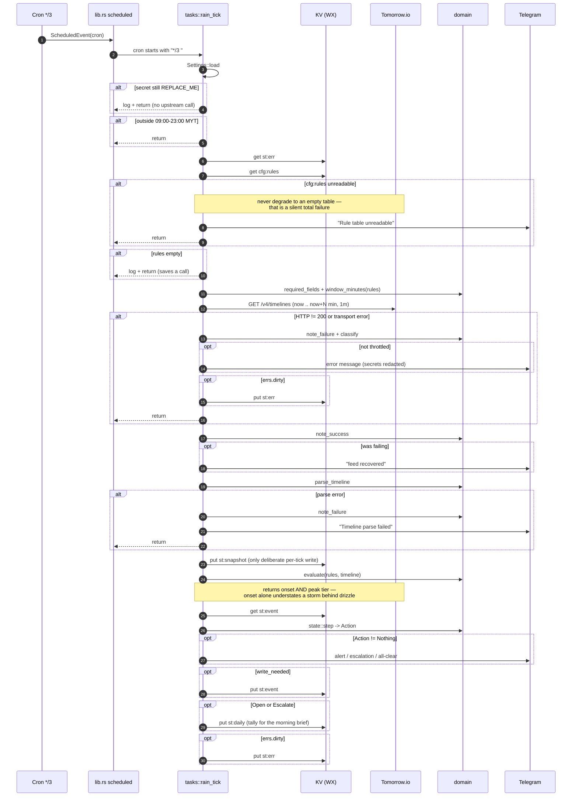
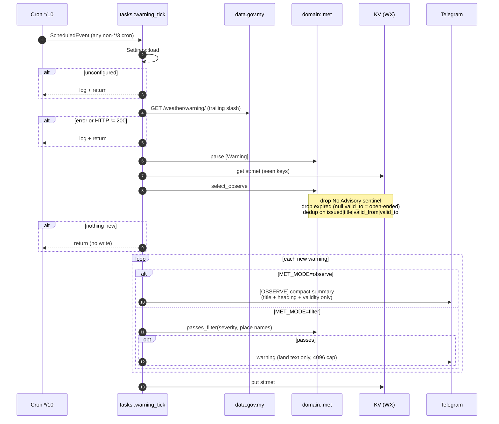
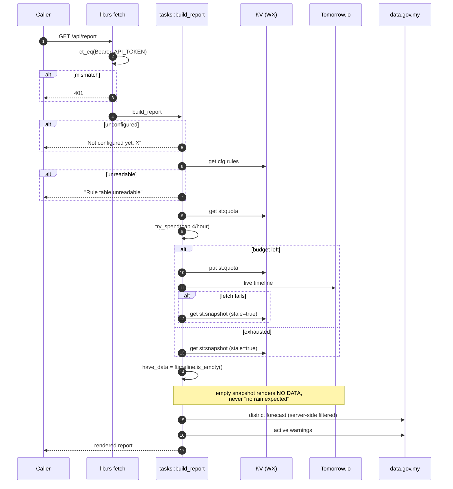
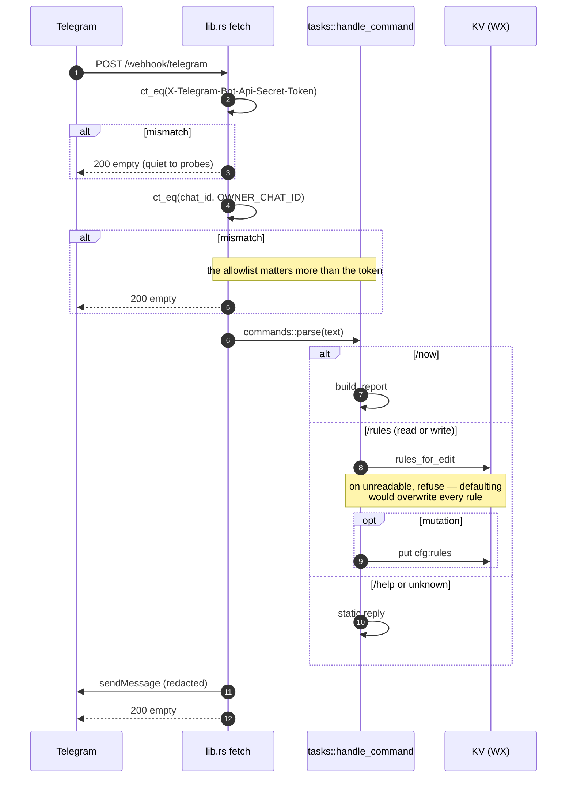
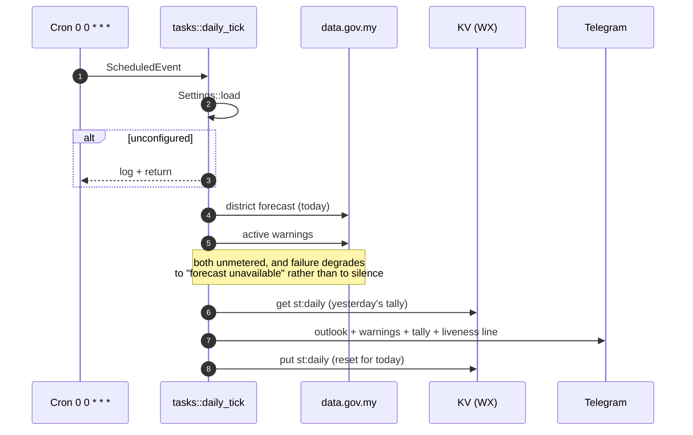

# Control flow

Four entry points. Every guard and early return below is real — the branches are
where this program's behaviour actually lives.

**This file is normative.** Any change to control flow must update it in the same
commit. See the "Keeping this file current" rule in [AGENTS.md](AGENTS.md).

| Entry point | Trigger | Handler |
|---|---|---|
| Rain path | cron `*/3 1-14 * * *` | `tasks::rain_tick` |
| Disaster path | cron `*/10 * * * *` | `tasks::warning_tick` |
| Report | `GET /api/report` | `tasks::build_report` |
| Bot commands | `POST /webhook/telegram` | `tasks::handle_command` |
| Morning brief | cron `0 0 * * *` (08:00 MYT) | `tasks::daily_tick` |

---

## 1. Rain path — `tasks::rain_tick`

Two gates keep this inside the 1,000 writes/day budget: `write_needed` for
`st:event` and `dirty` for `st:err`. A healthy tick writes only `st:snapshot`.

The fetch window is `window_minutes(rules)` — the widest enabled `lead_min` plus a
5-minute buffer, clamped to 30..=120. A longer window costs no extra API call,
only a longer response, so a rule asking for 45 minutes of warning gets it.

---

## 2. Event state machine — `domain::state::step`

This is what turns a condition that matches on ~7 consecutive ticks into one
message.

```mermaid
flowchart TD
    S([step]) --> M{condition<br/>matched?}

    M -->|no| O1{event open?}
    O1 -->|no| N1[Nothing<br/>no write]
    O1 -->|yes| Q{quiet >= 30 min?}
    Q -->|no| N2[Nothing<br/>no write]
    Q -->|yes| CL[Close<br/>ALL-CLEAR + write]

    M -->|yes| O2{event open?}
    O2 -->|no| OP[Open<br/>ALERT + write]
    O2 -->|yes| T{peak tier ><br/>stored peak?}
    T -->|yes| ES[Escalate<br/>ALERT + write]
    T -->|no| N3[Nothing<br/>no write<br/>same or lower tier]
```

The ratchet compares **peak** tiers, so a forecast that worsens anywhere inside
the lead window escalates even when the onset time has not moved.

Tier only ratchets upward inside an open event; the peak is retained until close,
so falling intensity is silent. Three of the six outcomes write nothing — that is
what keeps 280 daily ticks inside the KV budget.

(Drawn as a decision tree rather than a state diagram on purpose: the three
distinct `Open -> Open` transitions collapse into one edge in `stateDiagram-v2`,
which silently hides the escalation path.)

---

## 3. Disaster path — `tasks::warning_tick`

Runs 24/7 and is never silenced by the active window.

Observe mode sends the compact form deliberately: the severity vocabulary being
harvested lives in `title_en` and `heading_en`, so forwarding 1.5 KB of prose per
warning would add noise without adding signal. Filter mode sends the full land text.

Sending precedes the `st:met` write on purpose: delivery is at-least-once, so a
failed write costs a duplicate rather than a dropped warning.

---

## 4. Report — `GET /api/report` and `/now`

The 4/hour manual cap sits under the 5 calls/hour the cron leaves unused, so a
manual report can never push the cron path into a 429.

---

## 5. Bot commands — `POST /webhook/telegram`

`/health` is answered before `Settings::load`, so it works even when the Worker
is unconfigured.

---

## 6. Morning brief — `tasks::daily_tick`

Runs at 08:00 MYT, before the rain window opens. Carries the day's outlook and,
more importantly, proves the monitor is alive.

The final line of the message states the contract explicitly: *"If this message
stops arriving, the monitor is down."* Without it, a dead Worker and a quiet day
produce identical output — silence — which is the one failure mode an alerting
system cannot have. The brief is sent even when both MET calls fail, because its
primary job is liveness, not weather.

The tally (`st:daily`, counts of opens by tier plus escalations) exists so
thresholds can be tuned from what actually fired rather than from guesswork.
